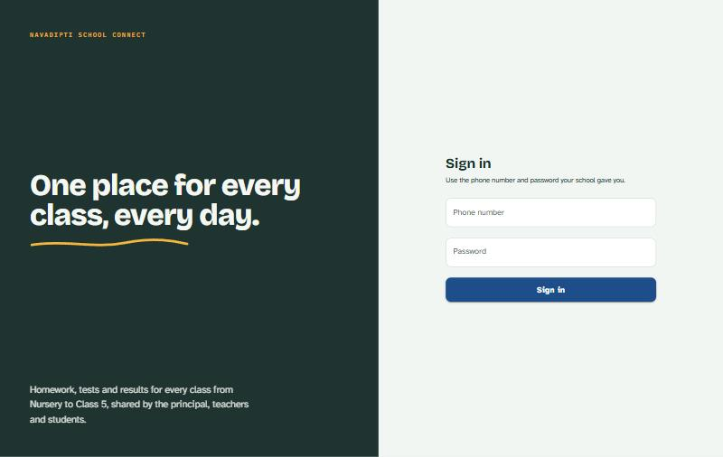
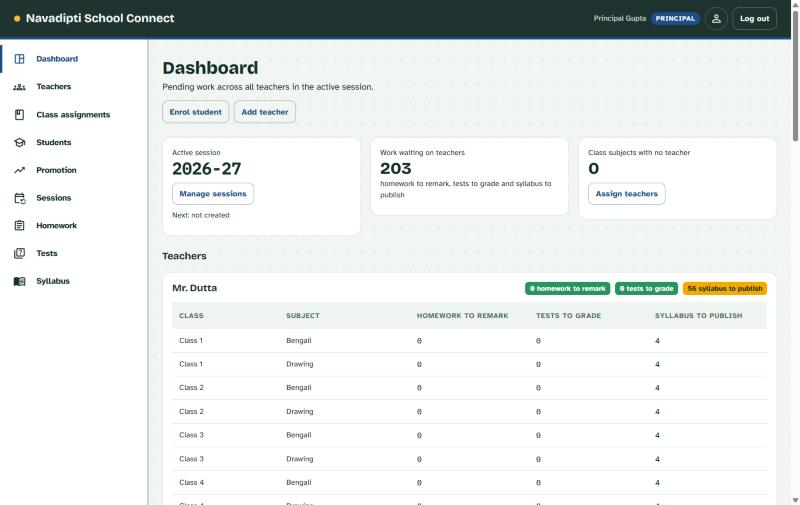
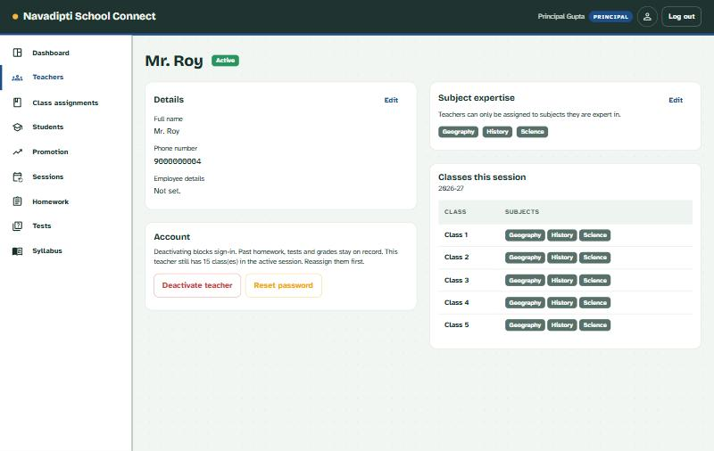
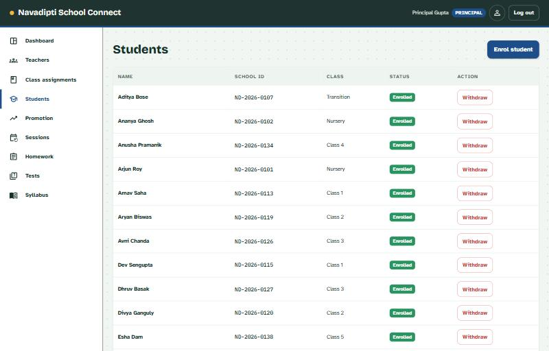
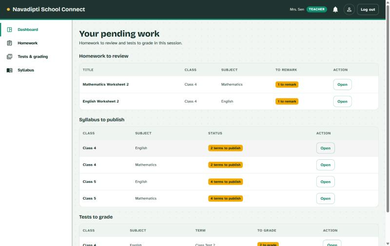
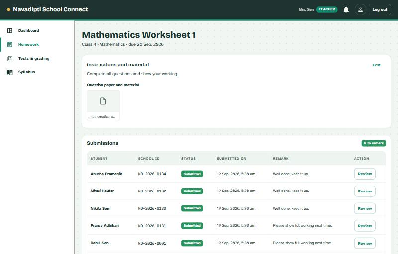
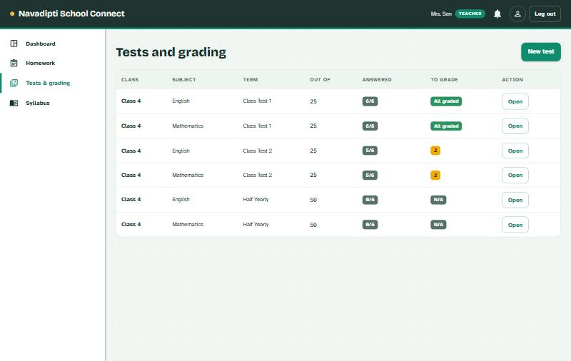
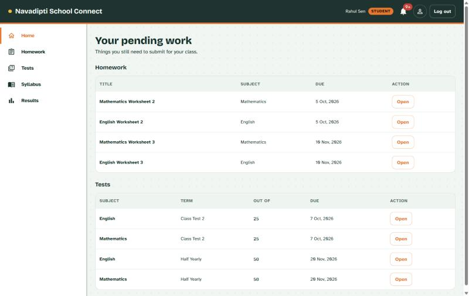
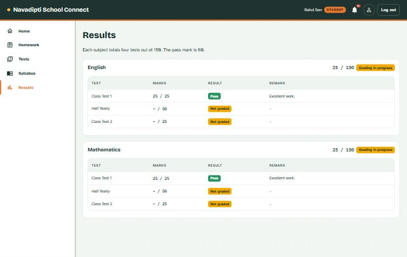

# Navadipti School Connect

**One place for every class, every day.** A school-management web app that connects a principal, teachers and students around the same homework, tests, syllabus and results — for schools running classes from Nursery to Class 5.

**Live demo:** [navadipti-school-connect.vercel.app](https://navadipti-school-connect.vercel.app)



---

## Try it yourself

The live demo is seeded with realistic data — 5 teachers, 42 students across all 7 classes, and homework/tests/syllabus in every state (graded, pending, overdue, upcoming). Sign in with any of these:

| Role | Phone number | Password |
|---|---|---|
| Principal | `9000000000` | `s3B9SRweJOib` |
| Teacher (Mrs. Sen — Maths & English, Class 4/5) | `9000000001` | `s3B9SRweJOib` |
| Student (Rahul Sen — Class 4) | `9000000002` | `s3B9SRweJOib` |

All data is synthetic — there are no real students or staff behind these accounts.

---

## What is this, in plain terms?

Most small schools track homework, test marks and syllabus progress across registers, WhatsApp messages and paper notices — scattered, hard to search, and invisible to parents until report-card day. Navadipti School Connect puts all of that in one web app with three views of the same underlying data:

- **The principal** sees the whole school at a glance: which teachers haven't published a syllabus yet, which classes have no teacher assigned, who still needs to grade a test.
- **A teacher** sees their own pending work — homework to remark, tests to grade, syllabus to publish — and can post homework, set tests, upload material, and release grades to a class.
- **A student** sees their own homework, tests and results, and can submit work (including photos/PDFs of handwritten answers) through the same screen they check their due dates on.

Nothing here requires a school to already have "digital" infrastructure — accounts are created by the principal/teachers, and students sign in with a phone number and a password they were handed, the same way they'd be handed a username for anything else.

---

## The three portals

### Principal



The principal's dashboard rolls up pending work across *every* teacher in one table — homework still waiting to be remarked, tests still waiting to be graded, syllabus terms still unpublished — so a gap doesn't stay invisible until a parent complains. From here the principal can also:
- Enrol students and issue them a school ID and a temporary password
- Add teachers and assign them to a class + subject (restricted to subjects they're marked as expert in)
- Create a new academic session, and promote a class's roster into the next one
- Review or deactivate any account



Each teacher's own page shows their subject expertise, every class they're currently teaching (grouped by class, not repeated per subject), and account actions like deactivation or a password reset.



Every enrolled student, searchable by class, with one-click withdrawal if a student leaves.

### Teacher



A teacher's dashboard is just their own to-do list: homework submissions waiting for a remark, syllabus terms not yet published, tests with ungraded submissions — scoped to the classes they actually teach.



Opening a piece of homework shows the original instructions and any attached material, plus a live submission table — who's submitted, when, and a free-text remark per student. Teachers can attach question papers, worksheets or reference material (PDF or image) to homework, tests and syllabus entries.



Every test a teacher has set, with submission and grading progress at a glance, across every class-subject combination and every term of the session.

### Student



A student's home screen is exactly what's still due — no digging through a class-wide homework list to find their own.



Marks are released per test, not all at once, and each subject shows a running total against the term structure (two class tests, a half-yearly, an annual) so a student can see where they stand before the next exam.

---

## How it's built (for the technically curious)

### Stack

- **[Next.js 16](https://nextjs.org)** (App Router, Turbopack) — React 19 on the frontend, API routes on the backend, one deployable unit
- **[Prisma 7](https://www.prisma.io)** with the Postgres driver adapter — typed database access and migrations
- **[PostgreSQL](https://www.postgresql.org)**, hosted on [Supabase](https://supabase.com) in production
- **[MUI](https://mui.com)** (Material UI) for the component library, **[TanStack Query](https://tanstack.com/query)** for client-side data fetching/caching
- **S3-compatible object storage** ([Supabase Storage](https://supabase.com/storage)) for uploaded files
- **[jose](https://github.com/panva/jose)** for signed JWT session cookies, **[bcryptjs](https://github.com/dcodeIO/bcrypt.js)** for password hashing
- Deployed on **[Vercel](https://vercel.com)**

### Authentication & roles

There's no sign-up flow. Accounts are provisioned by someone with authority to do so — the principal creates teacher and student accounts (and gets handed back a temporary password to pass along). Login is phone number + password; a successful login sets a signed, `httpOnly` JWT cookie that encodes the user's id and role. Every API route and page checks that cookie and the user's `Role` (`PRINCIPAL` / `TEACHER` / `STUDENT`) before doing anything — a teacher's API calls are additionally scoped to only the classes they're assigned to, not every class in the school.

### Data model, at a glance

The schema is built around an **academic session** (e.g. "2026-27"), which contains **terms** (CT1, CT2, Half Yearly, Annual) and **class offerings** (a `SchoolClass` within that session — e.g. "Class 4, 2026-27"). Each class offering has **offering subjects** (the subjects taught in that class that session), and a `TeacherAssignment` links one teacher to one offering subject. Students **enrol** into a class offering, which is what makes them show up in that class's homework, tests and syllabus.

Homework, tests and syllabus entries all hang off an offering subject + term. Submissions (`HomeworkSubmission`, `TestSubmission`) belong to one student and one assignment, with a database-level unique constraint preventing duplicate submissions. File uploads (`Attachment`) can belong to any of these — homework material, a test's question paper, a syllabus note, or a student's own submitted photo/PDF — tracked generically by an owner type + owner id rather than a separate table per attachment use case.

This structure is what lets the principal's dashboard answer "which teacher hasn't published syllabus for Class 4 Half Yearly" as a single query, rather than something assembled by hand.

### How a file upload actually works

Nothing is ever stored as a blob in Postgres, and the browser never talks to object storage directly:

1. A student or teacher picks a file in the browser. It's sent to the app's own API route, `POST /api/attachments`.
2. The server checks the uploader actually owns (or teaches, or is enrolled in) whatever the file is attached to, then streams the file to the object storage bucket using server-side credentials, and stores just the resulting key plus metadata in Postgres (`Attachment.fileUrl` is a storage key, not a public URL).
3. To view a file later, the browser asks the app for `GET /api/attachments/{id}` — the server re-checks ownership, fetches the bytes from storage, and relays them back. The storage bucket itself is private; there's no world-readable URL to leak.

This means switching storage providers (which happened during this project — from local disk in early development to Supabase's S3-compatible storage for production) only ever touches one file (`lib/storage.ts`), because every caller only ever calls three functions: `saveFile`, `readStoredFile`, `deleteStoredFile`.

### Deployment

The app is a single Next.js deployment on Vercel, connected to this GitHub repository (pushes to `master` auto-deploy). The database is Postgres on Supabase, accessed through Supabase's connection pooler — Vercel's serverless functions are short-lived and can spin up many at once, so a pooled connection (rather than one direct connection per request) keeps the app from exhausting Postgres's connection limit under load. Migrations are applied with `prisma migrate deploy` against a direct connection, since schema changes need a session-level lock that connection pooling doesn't support.

---

## Running it locally

```bash
git clone https://github.com/Noob0799/navadipti-school-connect.git
cd navadipti-school-connect
npm install
cp .env.example .env   # then fill in the values below
npx prisma migrate deploy
npx tsx prisma/seed.ts
npm run dev
```

`.env` needs:

| Variable | What it's for |
|---|---|
| `DATABASE_URL` | Postgres connection string |
| `AUTH_SECRET` | Signs session cookies — generate with `node -e "console.log(require('crypto').randomBytes(48).toString('base64url'))"` |
| `SEED_DEV_PASSWORD` | Password the seed script sets for every demo account it creates (dev only) |
| `S3_ENDPOINT`, `S3_REGION`, `S3_ACCESS_KEY_ID`, `S3_SECRET_ACCESS_KEY`, `S3_BUCKET_NAME` | S3-compatible object storage for file uploads |

The seed script is idempotent — safe to re-run any time, it only ever adds or updates, never deletes.
